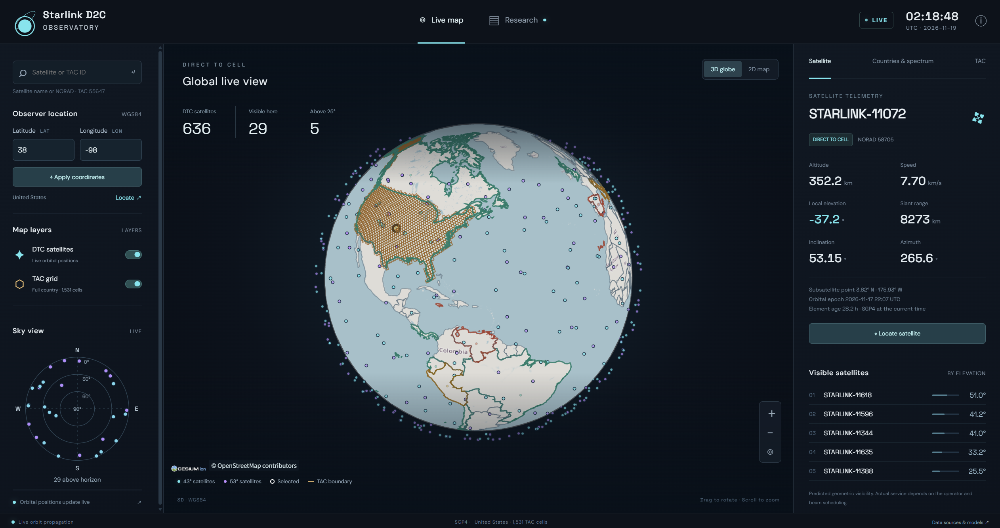

# Starlink D2C Observatory

An interactive research platform for exploring Starlink Direct-to-Cell satellites, sky visibility, TAC models, and partner spectrum data.

## Features & Usage

| Feature | Usage |
| --- | --- |
| 2D&nbsp;/&nbsp;3D&nbsp;Map | Switch views, rotate, and zoom to explore the constellation. Blue dots indicate 43° orbits; purple dots indicate 53° orbits. |
| Satellite&nbsp;Tracking | Click a satellite to display its orbit and parameters. Positions are updated every second using SGP4. |
| Observer&nbsp;Location | Enter coordinates or select a location on the globe. Click the Observer marker again to clear the selection. |
| Live&nbsp;Sky&nbsp;View | View satellites above the selected location's horizon. Click a dot for satellite details. The plot stays empty until a location is selected. |
| TAC&nbsp;Model | Search a TAC ID or select a country to view its model grid. Click the selected country again to hide all TAC cells. This is a research model, not confirmed live beam coverage. |
| Countries&nbsp;&amp;&nbsp;Spectrum | Search countries, operators, or bands to view service stages, frequency pairs, LTE bands, and PLMNs. |
| Research | Browse selected studies by publication date, search by keyword, and open original sources. |
